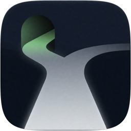

> *Дисклеймер: README сгенерирован моделью qwen без правок автора.*

<p align="center">
  
</p>

# AWG App Router

Пер-приложенческий split-tunnel для macOS (Apple Silicon): выбранные
приложения **и их дочерние процессы** идут через выбранный
[AmneziaWG](https://amnezia.org)-туннель, весь остальной трафик и системный
DNS — напрямую через роутер, как обычно. Без Apple Developer ID, без
профиля NEProvider — честный TUN + root-демон.

## Зачем это нужно

Типичная VPN-утилита поднимает туннель на всю машину. Иногда нужно ровно
обратное: через туннель должен ходить **конкретный** процесс — браузер,
терминал, CLI-инструмент, AI-ассистент, — а всё остальное (стриминги,
локальная сеть, принтер, умный дом) — как ни в чём не бывало через обычного
провайдера.

Особенно важно для CLI: у командной строки за спиной всегда дерево дочерних
процессов (`node` → `python` → shell-утилиты). AWG App Router тащит через
туннель всё дерево целиком, а не только головной бинарь.

Плюсы такой схемы:

- у «туннельных» приложений — IP адрес туннельного сервера, у остальных —
  ваш обычный белый IP роутера (никаких банов за «подозривный» exit);
- несколько AmneziaWG-серверов одновременно, каждому приложению — свой;
  переключение сервера приложением — мгновенно, без рестарта туннеля;
- роутер не трогается вообще — туннель живёт только на этой машине;

## Как это работает

```
[GUI: menu-bar app]  --XPC-->  [root LaunchDaemon]
       состояние: снимок            |
                                    +-- порождает ядро amnezia-box (Go, форк sing-box)
                                    |      TUN (gVisor netstack), один на все серверы
                                    |      N awg-outbound + selector на каждое приложение
                                    |      DNS: fake-ip (198.18.0.0/15) — утечек нет
                                    |      process-правила: порт → PID → цепочка предков
                                    +-- pf kill switch (inline, quick, до anchor "com.apple/*")
```

### Архитектура

- **Одно ядро, один TUN, N серверов.** Все добавленные AmneziaWG-серверы
  живут в одном процессе `awgapprouter-box` (amnezia-box с `with_awg`).
  Каждому серверу — свой `urltest`-аутбаунд, каждое приложение — селекторная
  группа. Смена сервера приложением = `PUT` в локальный Clash API, туннель
  не дёргается.
- **Матчинг процессов — три слоя.** Правило компилируется в пути исполняемых
  файлов; ядро по сокету определяет PID (libproc), затем поднимается по
  цепочке предков: дочерние процессы унаследованного приложения
  (npm/pip/shell-обвязка CLI) идут в тот же туннель.
- **root-демон — единственный источник правды.** GUI — тонкий пульт: шлёт
  намерения по XPC (`com.awgapprouter.daemon`), рендерит снимок состояния,
  который демон пушит при любом изменении. Индикаторы не могут «разойтись».
- **Kill-switch, который нельзя «забыть» включить.** «Выключить» =
  *тюрьма*: туннеля нет, выбранные приложения сидят без сети (это защита от
  тихой утечки через роутер), состояние переживает закрытие GUI и
  перезагрузку. Снять тюрьму можно только «Выключить полностью» — с паролем
  администратора. Если туннель умер, а demon жив — WAN пломбируется pf
  (пускаются только LAN/DHCP/mDNS/endpoint туннеля), при подъёме tun пломба
  снимается сама.

### Ограничения и минусы (честно)

- **macOS, Apple Silicon.** Ядро собирается под хост-архитектуру; Intel —
  только свои руки и `GOARCH=amd64`.
- **Нет подписи разработчика.** Бинарь подписан ad-hoc — Gatekeeper придётся
  уломать один раз (см. установку).
- **pf-пломба живёт до перезагрузки.** После принудительного съёма демона
  вручную пломбированные правила остаются до `pfctl -f /etc/pf.conf` или
  ребута — иначе это была бы не защита, а декорация. Утечки не будет, но
  сеть может оказаться закрытой до перезагрузки.
- **Залипшие сокеты.** TCP-соединения, открытые приложением *до* включения
  туннеля, останутся direct — это кэш маршрутизации ядра, не баг. GUI честно
  считает: «⚠ N direct» — лечится рестартом приложения.
- **Safari/WebKit матчинг не готов** — системные браузеры с их XPC-архитектурой
  в списке todo.
- **Приложения с захардкоженным DNS или certificate pinning** могут
  капризничать из-за fake-ip.
- **Переключение «выключить полностью» рвёт трафик** на секунды (смена
  состава аутбаундов требует рестарта ядра). Hot-select работает для смены
  сервера *между включёнными* серверами.
- pf-пломба и маршрутизация — системный уровень: возможны конфликты с другим
  VPN/фильтрующим софтом (pf на macOS один, он общий).

## Установка

### Из релиза (готовый .app)

1. Скачайте `AWG-App-Router.zip` из [Releases](../../releases),
   распакуйте в `/Applications` (или куда удобно).
2. Gatekeeper попросит покладистости — бинарь подписан ad-hoc:
   - **Finder**: правый клик по приложению → «Открыть» → «Открыть» (один раз);
   - или в терминале:
     ```sh
     xattr -dr com.apple.quarantine "/Applications/AWG App Router.app"
     ```
3. Запустите. Приложение само спросит пароль администратора и установит
   LaunchDaemon + бинари (это один раз на машину).
4. В окне: «+ Сервер» → вставьте `.conf` AmneziaWG-конфигурации (несколько
   серверов — можно), «+ Приложение» → выберите приложение из списка (GUI)
   или укажите путь к CLI-бинарю. Привяжите приложение к серверу,
   нажмите «Подключиться».
5. В «Настройках» — тумблеры автозапуска демона/UI и «автоподключать
   нужные серверы при старте».

Удаление: `sudo "/Applications/AWG App Router.app/Contents/Resources/uninstall-privileged.sh"`
(снимает демон, бинари, конфиги с ключами, пломбу pf).

### Из исходников

Зависимости (macOS 13+, Apple Silicon):

- **Xcode Command Line Tools** (Swift 5.9+);
- **Go 1.22+** (для ядра; Xcode для ядра не нужен);
- git, python3.

```sh
git clone https://github.com/alexgarbarev/awg_app_router.git
cd awg_app_router
scripts/fetch-vendor.sh     # клонирует amnezia-box + amneziawg-go в vendor/
scripts/build-core.sh       # Go → bin/awgapprouter-box (ad-hoc подпись)
scripts/build-app.sh        # Swift → "dist/AWG App Router.app"
open "dist/AWG App Router.app"   # первый запуск попросит пароль — установит демон
```

Ядро собирается go-тегами sing-box: `with_gvisor,with_awg,with_quic,with_utls,
with_clash_api,with_dhcp,with_wireguard`.

## Безопасность и секреты

- Приватные ключи живут в `/etc/awgapprouter/servers.json` (root:wheel 600)
  — в git не попадают никогда; `*.conf` и рабочие конфиги ядра в `.gitignore`.
- Удаление (`uninstall-privileged.sh`) сносит `/etc/awgapprouter` целиком.
- pf-правила — только `quick` и вставлены ПЕРЕД `anchor "com.apple/*"`
  (в pf без `quick` выигрывает последнее совпадение).

## Структура репозитория

```
Sources/AWGAppRouterKit/   общий код: парсер .conf, генератор config.json, XPC-контракт
Sources/AWGAppRouter/      menu-bar приложение (AppKit)
Sources/awgapprouterd/     root-демон: ядро, tun-надзор, pf-пломба, Clash API
Resources/                 Info.plist, LaunchDaemon plist, install/uninstall-скрипты, иконки
scripts/                   fetch-vendor.sh, build-core.sh, build-app.sh, утилиты
vendor/                    не в git; восстановление: scripts/fetch-vendor.sh
```

## Авторы

- **Aleksey Garbarev** — идея, продукт, постановка задач.
- **qwen 3.8 flash next** — код (проект написан в паре с AI-агентом).

## Лицензия

- Наш код (Swift, скрипты, ресурсы этого репозитория) — **MIT** (см. [LICENSE](LICENSE)).
- `awgapprouter-box` собирается из:
  - [amnezia-box](https://github.com/amnezia-vpn/amnezia-box) (форк
    [sing-box](https://github.com/SagerNet/sing-box)) — **GPL-3.0**, поэтому
    собранный бинарь ядра распространяется под GPL-3.0;
  - [amneziawg-go](https://github.com/amnezia-vpn/amneziawg-go) — **MIT**;
  - [gVisor netstack](https://gvisor.dev) (компилируется в ядро) — **Apache-2.0**.
